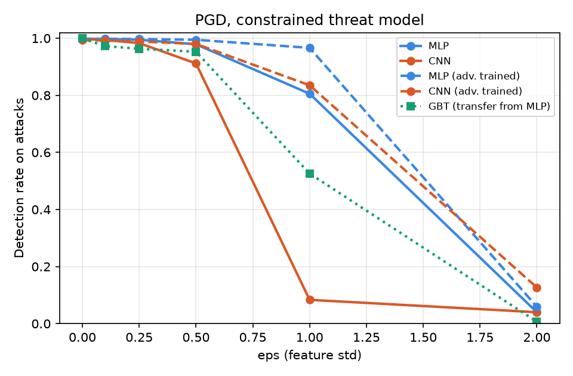
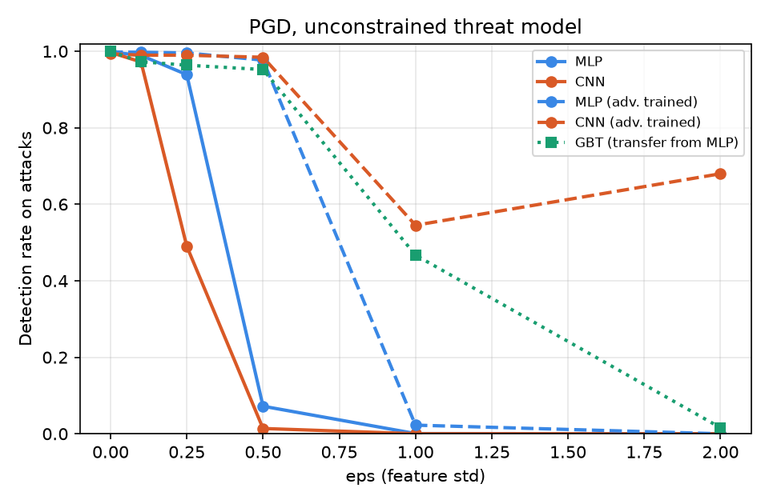

# Adversarial Robustness of Neural Intrusion Detectors

[](https://github.com/ziko-asm/ai-nids-adversarial-benchmark/actions/workflows/ci.yml)

A neural network can reach 99.9% accuracy on network intrusion detection. How easily can an attacker who shapes its own traffic slip past it, and does adversarial training help?

This repository trains an MLP and a 1D-CNN on KDD Cup 1999 and attacks them with FGSM and PGD under two threat models. It applies PGD adversarial training as a defence, checks whether the attacks transfer to a gradient-boosted tree model, and explains decisions with Integrated Gradients. Every number in this README and in the dashboard comes from `results/results.json`, which one command regenerates.

By [Ziya Azizov](https://www.linkedin.com/in/ziya-azizov-91bba638a). Companion project on graph-based detection: [GraphGuard IoT](https://graphguard-iot.vercel.app).

## Results

3 seeds · 145,586 unique records · 11,551 attack records in each test split · detection rate = share of attack records still flagged (mean ± std). ε is in feature standard deviations.

| Model | Defence | Clean | FGSM ε=0.5 | PGD ε=0.5 | PGD ε=0.5, constrained | PGD ε=1, constrained |
|---|---|---|---|---|---|---|
| MLP | none | 0.998 ± 0.000 | 0.419 ± 0.095 | 0.072 ± 0.009 | 0.979 ± 0.004 | 0.806 ± 0.041 |
| MLP | adv_train | 0.998 ± 0.000 | 0.990 ± 0.001 | 0.977 ± 0.005 | 0.995 ± 0.001 | 0.966 ± 0.007 |
| CNN | none | 0.997 ± 0.001 | 0.037 ± 0.020 | 0.014 ± 0.009 | 0.912 ± 0.020 | 0.083 ± 0.026 |
| CNN | adv_train | 0.993 ± 0.003 | 1.000 ± 0.000 | 0.984 ± 0.003 | 0.980 ± 0.004 | 0.835 ± 0.138 |
| GBT (transfer) | none | 0.999 ± 0.000 | — | 0.952 ± 0.011 | 0.953 ± 0.009 | 0.526 ± 0.209 |

### Key findings
1. **Unconstrained attacks overstate the threat.** If the attacker may change every input, PGD at ε = 0.5 cuts the MLP's detection rate from 0.998 to **0.07**. If protocol, service and TCP flag stay fixed and values stay in a realistic range, the same attack only reaches **0.98**, and it takes ε = 2 to break the model (0.04). Integrated Gradients explains the gap: the MLP relies most on `flag=SF` and `service=private`, which the attacker cannot change.
2. **The 1D-CNN is far more fragile than the MLP** at the same accuracy. Under constrained PGD at ε = 1 it keeps 0.08 against the MLP's 0.81. Its top attributions include `src_bytes` and `serror_rate`, which the attacker *can* move.
3. **PGD adversarial training works inside its budget and costs almost nothing clean.** Trained at ε = 0.25, the MLP holds 0.977 under unconstrained PGD at ε = 0.5 (from 0.072) and 0.966 under constrained PGD at ε = 1 (from 0.806). Clean detection rate is unchanged (0.998). Beyond twice the training budget it fails (0.02 at ε = 1, unconstrained).
4. **The adversarially trained CNN shows gradient masking.** FGSM detection is 1.000 at every ε, higher than on clean data. Unconstrained PGD is *less* effective at ε = 2 (0.68) than at ε = 1 (0.55). Both are classic signs that the loss surface hides gradients rather than the model being robust; its robustness numbers should not be trusted without gradient-free or adaptive attacks.
5. **Trees resist transfer at small budgets only.** PGD examples crafted on the MLP barely affect gradient-boosted trees at ε ≤ 0.5 (0.95), but at ε = 1 detection falls to 0.53 ± 0.21 and at ε = 2 to 0.02.
6. **Evasion depends on the attack family.** Under constrained PGD at ε = 0.5, `neptune` (SYN flood, 90% of attacks) stays at 0.999 because it sits far from normal traffic, while `warezclient` drops from 0.95 to 0.30 and `back` from 1.00 to 0.41. Adversarial training restores both (0.84 and 1.00).

 

## Setup

| | |
|---|---|
| **Data** | KDD Cup 1999, 10% subset: 494,021 records, **145,586 after removing exact duplicates**, 40% attacks |
| **Why de-duplicate** | Without it the same record appears in train and test and accuracy is inflated. Duplicates are removed before splitting |
| **Split** | 60 / 20 / 20, stratified, seeded; early stopping on validation F1 |
| **Features** | 38 numeric fields (log1p for counts and bytes) + one-hot protocol, service and flag = 117 inputs, standardised on train only |
| **Models** | MLP (128-64), 1D-CNN (2 conv layers), gradient-boosted trees (scikit-learn) |
| **Metric** | Detection rate (recall on attack records), plus F1, precision and ROC-AUC |
| **Repeats** | 3 seeds, mean ± std; full run takes about 10 minutes on a laptop CPU |

### Threat models
Only attack records are perturbed: the attacker controls its own malicious traffic and wants it labelled normal. Benign test traffic is untouched. ε is measured in standard deviations of each (transformed) feature.

| | Unconstrained | Constrained |
|---|---|---|
| Features the attacker may change | all 117 | 32 numeric traffic features |
| Frozen | none | protocol, service, TCP flag, `land`, `logged_in`, `root_shell`, `su_attempted`, `is_host_login`, `is_guest_login` |
| Value range | unbounded | kept inside the range seen in training |
| Purpose | upper bound, what most papers report | closer to a real attacker |

### Attacks and defence
- **FGSM** (Goodfellow et al., 2015): single gradient-sign step.
- **PGD-20** (Madry et al., 2018): 20 projected steps with random start.
- **Transfer to trees**: PGD examples crafted on the MLP or CNN are fed to gradient-boosted trees, which have no gradient to attack directly.
- **PGD adversarial training**: attack rows in every batch are replaced by PGD-7 examples at ε = 0.25.

### Explanations
Integrated Gradients (Sundararajan et al., 2017) against the mean benign record as baseline, on 2,000 attack records. The completeness error is reported as a sanity check. The benchmark also records which features PGD moves most and the detection rate per attack family (neptune, smurf, back, …).

## Reproduce

```bash
python -m venv .venv && source .venv/bin/activate     # Windows: .venv\Scripts\activate
pip install -r requirements.txt

# data (not stored in git)
mkdir data
curl -o data/kdd.gz http://kdd.ics.uci.edu/databases/kddcup99/kddcup.data_10_percent.gz
gunzip -c data/kdd.gz > data/kddcup.data_10_percent.csv

pytest -q                          # unit tests on synthetic data, no download needed
python -m src.evaluate --quick     # 1 seed, ~3 min on a laptop CPU
python -m src.evaluate             # 3 seeds, ~10 min
streamlit run src/app.py           # dashboard
python -m src.train --model mlp    # checkpoint for the API
uvicorn src.api:app --reload       # REST API, docs at /docs
```

## Layout

```
src/dataset.py     loading, de-duplication, preprocessing, attacker-mutable feature mask
src/models.py      MLP and 1D-CNN
src/attack.py      FGSM, PGD, threat models
src/utils.py       training (standard and adversarial), metrics
src/evaluate.py    benchmark -> results/results.json, plots, README table
src/explain.py     Integrated Gradients
src/train.py       train one model and save a checkpoint with its preprocessing
src/api.py         FastAPI: /predict on raw 41-field records, /results
src/app.py         Streamlit dashboard reading results.json
src/tests/         pytest suite (runs in CI on synthetic data)
```

## Limitations
- KDD Cup 1999 is old and synthetic-traffic based, with known artefacts. It is used here because it is small, public and standard. The protocol transfers directly to CIC-IDS2017 or UNSW-NB15.
- The constrained threat model freezes fields and bounds values, but does not enforce every dependency between features (for example, counts that must stay integers). A perturbed record may not correspond to a packet trace that exists.
- Evasion only; poisoning the training data is not covered.
- White-box attacks on the neural models. The tree model is attacked only by transfer, which is a lower bound on its vulnerability.
- The adversarially trained CNN shows gradient masking (finding 4); its PGD numbers are an upper bound on its true robustness.
