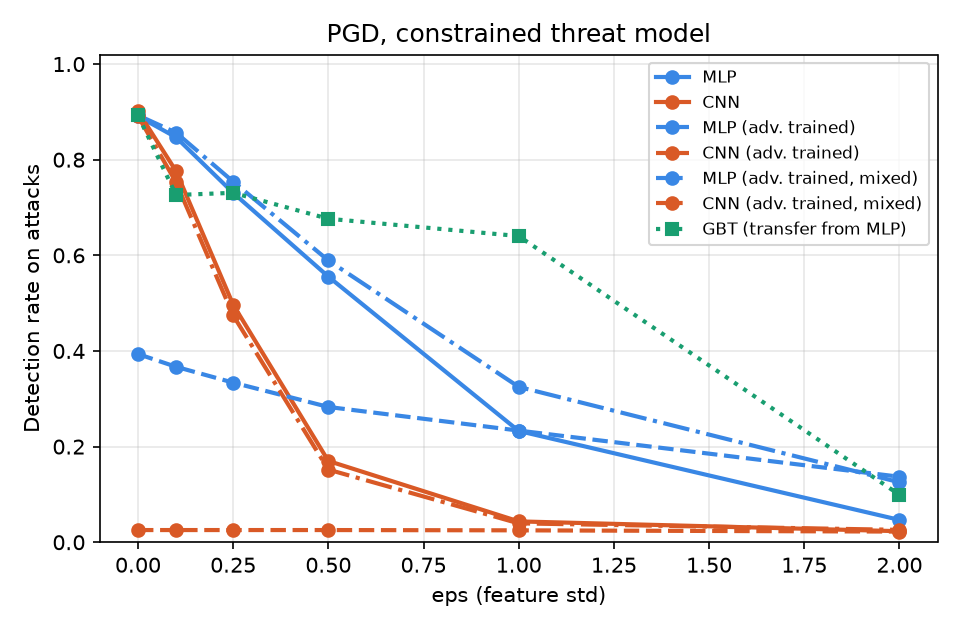
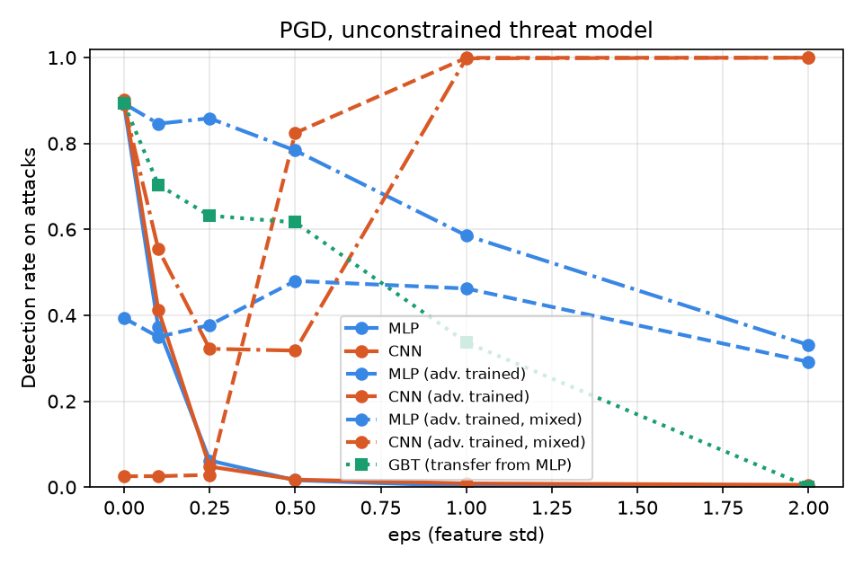
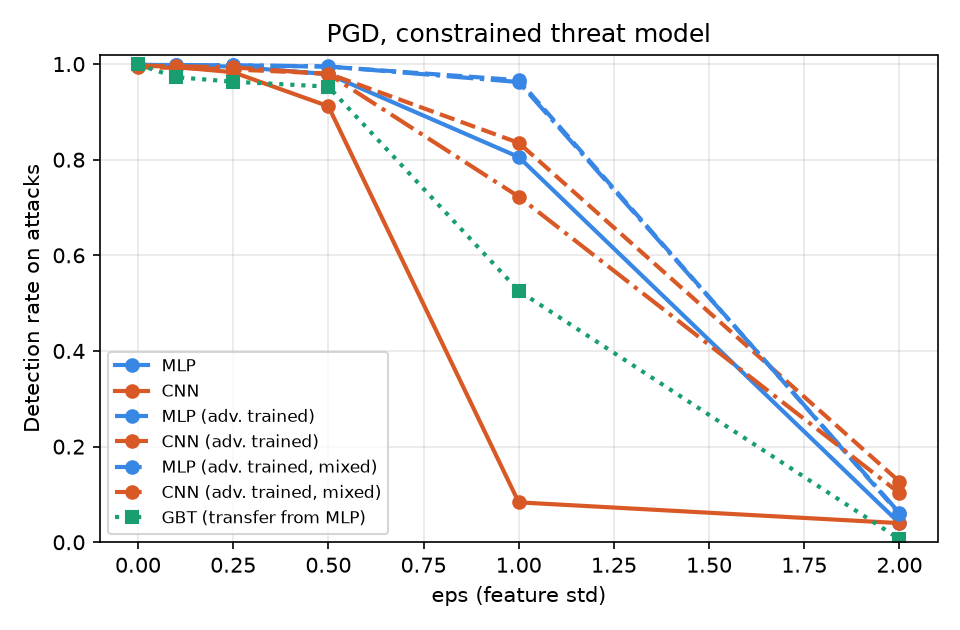
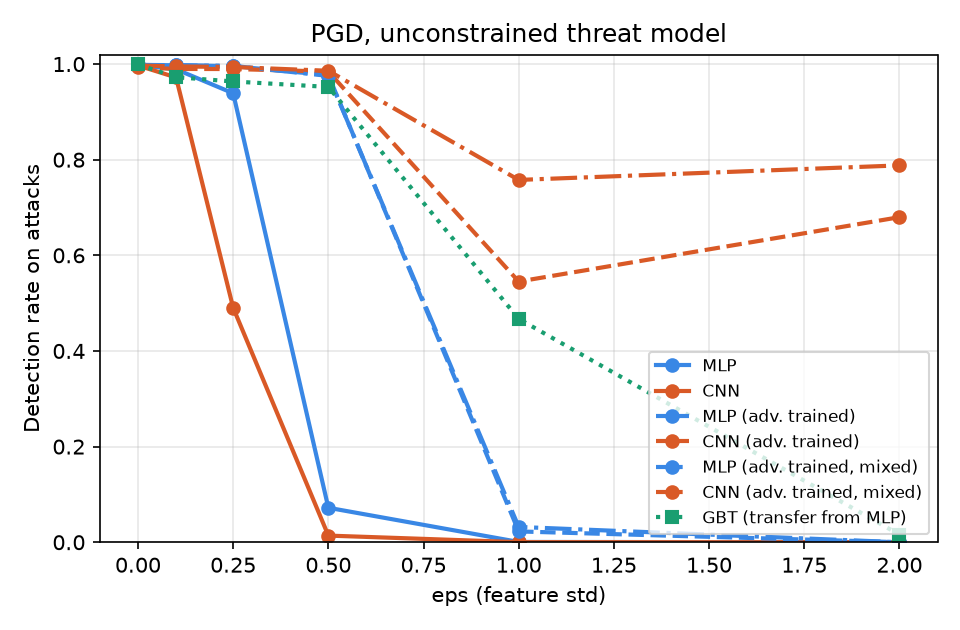

# Adversarial Robustness of Neural Intrusion Detectors

[](https://github.com/ziko-asm/ai-nids-adversarial-benchmark/actions/workflows/ci.yml)

A neural network can reach 99.9% accuracy on network intrusion detection. How easily can an attacker who shapes its own traffic slip past it, and does adversarial training help?

This repository trains an MLP and a 1D-CNN on two datasets, KDD Cup 1999 and the more recent UNSW-NB15, and attacks them with FGSM and PGD under two threat models. It applies two forms of PGD adversarial training as defences, checks whether the attacks transfer to a gradient-boosted tree model, measures how close attacks sit to benign traffic, and explains decisions with Integrated Gradients. Every number in this README and in the dashboard comes from `results/results.json` (KDD) and `results/unsw/results.json` (UNSW-NB15), which one command each regenerates.

**The headline:** the same detectors and the same attack that look robust on KDD Cup 1999 break on UNSW-NB15, and the standard defence collapses there. Attacks in UNSW-NB15 sit 3.7 times closer to benign traffic, which is enough to change every conclusion.

**Live dashboard: https://ai-nids-adversarial-benchmark-publi.vercel.app**

By [Ziya Azizov (ayfar)](https://ayfar.vercel.app) · [LinkedIn](https://www.linkedin.com/in/ziya-azizov-91bba638a). Companion project on graph-based detection: [GraphGuard IoT](https://graphguard-iot.vercel.app).

## Results

3 seeds per dataset · detection rate = share of attack records still flagged (mean ± std) · ε is in feature standard deviations. `adv_train` replaces each batch's attack rows with PGD examples; `adv_mix` adds the PGD examples next to the clean ones.

### KDD Cup 1999

145,586 unique records · 11,551 attack records in each test split.

| Model | Defence | Clean | FGSM ε=0.5 | PGD ε=0.5 | PGD ε=0.5, constrained | PGD ε=1, constrained |
|---|---|---|---|---|---|---|
| MLP | none | 0.998 ± 0.000 | 0.419 ± 0.095 | 0.072 ± 0.009 | 0.979 ± 0.004 | 0.806 ± 0.041 |
| MLP | adv_train | 0.998 ± 0.000 | 0.990 ± 0.001 | 0.977 ± 0.005 | 0.995 ± 0.001 | 0.966 ± 0.007 |
| MLP | adv_mix | 0.998 ± 0.000 | 0.988 ± 0.002 | 0.975 ± 0.005 | 0.995 ± 0.001 | 0.962 ± 0.009 |
| CNN | none | 0.997 ± 0.001 | 0.037 ± 0.020 | 0.014 ± 0.009 | 0.912 ± 0.020 | 0.083 ± 0.026 |
| CNN | adv_train | 0.993 ± 0.003 | 1.000 ± 0.000 | 0.984 ± 0.003 | 0.980 ± 0.004 | 0.835 ± 0.138 |
| CNN | adv_mix | 0.997 ± 0.001 | 1.000 ± 0.000 | 0.986 ± 0.011 | 0.979 ± 0.007 | 0.723 ± 0.109 |
| GBT (transfer) | none | 0.999 ± 0.000 | — | 0.952 ± 0.011 | 0.953 ± 0.009 | 0.526 ± 0.209 |

### UNSW-NB15

153,270 records after de-duplication · 13,593 attack records in each test split.

| Model | Defence | Clean | FGSM ε=0.5 | PGD ε=0.5 | PGD ε=0.5, constrained | PGD ε=1, constrained |
|---|---|---|---|---|---|---|
| MLP | none | 0.891 ± 0.005 | 0.066 ± 0.023 | 0.016 ± 0.001 | 0.555 ± 0.017 | 0.233 ± 0.016 |
| MLP | adv_train | 0.394 ± 0.082 | 0.993 ± 0.004 | 0.480 ± 0.047 | 0.283 ± 0.036 | 0.234 ± 0.015 |
| MLP | adv_mix | 0.893 ± 0.005 | 0.999 ± 0.000 | 0.784 ± 0.019 | 0.589 ± 0.026 | 0.325 ± 0.027 |
| CNN | none | 0.901 ± 0.003 | 0.259 ± 0.145 | 0.018 ± 0.005 | 0.170 ± 0.017 | 0.044 ± 0.004 |
| CNN | adv_train | 0.025 ± 0.001 | 1.000 ± 0.000 | 0.825 ± 0.037 | 0.025 ± 0.001 | 0.025 ± 0.000 |
| CNN | adv_mix | 0.891 ± 0.011 | 1.000 ± 0.000 | 0.318 ± 0.067 | 0.152 ± 0.019 | 0.040 ± 0.003 |
| GBT (transfer) | none | 0.892 ± 0.002 | — | 0.616 ± 0.012 | 0.676 ± 0.021 | 0.640 ± 0.053 |

### How close attacks sit to benign traffic

L∞ distance from 2,000 test attacks to the nearest of 40,000 benign training records, in the model's input space (seed 0). No detector can be robust at budget ε for an attack whose nearest benign record is closer than ε.

| | Median distance | Within 0.25 | Within 0.5 | Within 1.0 |
|---|---|---|---|---|
| KDD Cup 1999 | 2.20 | 0.05% | 0.15% | 0.3% |
| UNSW-NB15 | 0.60 | 8.0% | 31.0% | 68.2% |

### What changes on UNSW-NB15
1. **The same detectors are far more fragile, even against a realistic attacker.** Under constrained PGD at ε = 0.5 the MLP keeps 0.555 of its detections (0.979 on KDD) and the CNN 0.170 (0.912). At ε = 1 they keep 0.233 and 0.044.
2. **The reason is geometry, not the models.** The median attack is 0.60 standard deviations from a benign record, against 2.20 on KDD; 31% of attacks have a benign neighbour within ε = 0.5. KDD's attack classes are so far from normal traffic that robustness there comes almost for free.
3. **Standard adversarial training collapses.** Replacing attack rows with PGD examples at ε = 0.25 drops the MLP's clean detection rate to 0.394 and the CNN's to 0.025. Both still flag 99–100% of FGSM examples: they learned to recognise the perturbation, not the intrusion, because during training they never see an unperturbed attack.
4. **Mixed adversarial training avoids the collapse but its robustness is overstated.** Keeping clean attacks next to the PGD examples restores clean detection (MLP 0.893, CNN 0.891) and lifts unconstrained PGD at ε = 0.5 from 0.016 to 0.784 for the MLP. Two signs say not to trust that number: FGSM detection (0.999) is higher than clean detection, and the constrained attack, which may only do a subset of what the unconstrained one does, is stronger (0.589). Against the realistic attacker the gain is small (0.555 to 0.589).
5. **Trees hold up better under transfer.** PGD examples crafted on the MLP leave gradient-boosted trees at 0.676 under the constrained threat model at ε = 0.5, against 0.555 for the attacked MLP itself. Transfer is a lower bound on the trees' vulnerability, so this does not show they are robust.

 

### Key findings on KDD Cup 1999
1. **Unconstrained attacks overstate the threat.** If the attacker may change every input, PGD at ε = 0.5 cuts the MLP's detection rate from 0.998 to **0.07**. If protocol, service and TCP flag stay fixed and values stay in a realistic range, the same attack only reaches **0.98**, and it takes ε = 2 to break the model (0.04). Integrated Gradients explains the gap: the MLP relies most on `flag=SF` and `service=private`, which the attacker cannot change.
2. **The 1D-CNN is far more fragile than the MLP** at the same accuracy. Under constrained PGD at ε = 1 it keeps 0.08 against the MLP's 0.81. Its top attributions include `src_bytes` and `serror_rate`, which the attacker *can* move.
3. **PGD adversarial training works inside its budget and costs almost nothing clean.** Trained at ε = 0.25, the MLP holds 0.977 under unconstrained PGD at ε = 0.5 (from 0.072) and 0.966 under constrained PGD at ε = 1 (from 0.806). Clean detection rate is unchanged (0.998). Beyond twice the training budget it fails (0.02 at ε = 1, unconstrained).
4. **The adversarially trained CNN shows gradient masking.** FGSM detection is 1.000 at every ε, higher than on clean data. Unconstrained PGD is *less* effective at ε = 2 (0.68) than at ε = 1 (0.55). Both are classic signs that the loss surface hides gradients rather than the model being robust; its robustness numbers should not be trusted without gradient-free or adaptive attacks. UNSW-NB15 shows the same pattern in a much stronger form (finding 3 above). Mixed adversarial training does not remove it here: the CNN's FGSM detection stays at 1.000.
5. **Trees resist transfer at small budgets only.** PGD examples crafted on the MLP barely affect gradient-boosted trees at ε ≤ 0.5 (0.95), but at ε = 1 detection falls to 0.53 ± 0.21 and at ε = 2 to 0.02.
6. **Evasion depends on the attack family.** Under constrained PGD at ε = 0.5, `neptune` (SYN flood, 90% of attacks) stays at 0.999 because it sits far from normal traffic, while `warezclient` drops from 0.95 to 0.30 and `back` from 1.00 to 0.41. Adversarial training restores both (0.84 and 1.00).

 

## Setup

| | |
|---|---|
| **Data, KDD** | KDD Cup 1999, 10% subset: 494,021 records, **145,586 after removing exact duplicates**, 40% attacks |
| **Data, UNSW-NB15** | Official training and testing CSVs pooled: 257,673 records, 154,098 after removing duplicates, then 828 dropped whose identical features carry both labels: **153,270 records**, 44% attacks. The `id` column is dropped |
| **Why de-duplicate** | Without it the same record appears in train and test and accuracy is inflated. Duplicates are removed before splitting |
| **Split** | 60 / 20 / 20, stratified, seeded, the same protocol for both datasets; early stopping on validation F1 |
| **Features, KDD** | 38 numeric fields (log1p for counts and bytes) + one-hot protocol, service and flag = 117 inputs, standardised on train only |
| **Features, UNSW-NB15** | 39 numeric fields (log1p for counts, bytes, rates and times) + one-hot protocol, service and state = 194 inputs, standardised on train only |
| **Models** | MLP (128-64), 1D-CNN (2 conv layers), gradient-boosted trees (scikit-learn) |
| **Metric** | Detection rate (recall on attack records), plus F1, precision and ROC-AUC |
| **Repeats** | 3 seeds, mean ± std; a full run takes 40–70 minutes per dataset on a laptop CPU |

### Threat models
Only attack records are perturbed: the attacker controls its own malicious traffic and wants it labelled normal. Benign test traffic is untouched. ε is measured in standard deviations of each (transformed) feature.

| | Unconstrained | Constrained |
|---|---|---|
| Features the attacker may change | all (117 KDD, 194 UNSW) | 32 KDD, 23 UNSW numeric traffic features |
| Frozen, KDD | none | protocol, service, TCP flag, `land`, `logged_in`, `root_shell`, `su_attempted`, `is_host_login`, `is_guest_login` |
| Frozen, UNSW-NB15 | none | protocol, service, state, `is_ftp_login`, `is_sm_ips_ports`, and everything the destination produces: `dpkts`, `dbytes`, `dttl`, `dload`, `dloss`, `dinpkt`, `djit`, `dwin`, `dtcpb`, `dmean`, `synack`, `tcprtt`, `response_body_len`, `ct_state_ttl` |
| Value range | unbounded | kept inside the range seen in training |
| Purpose | upper bound, what most papers report | closer to a real attacker |

### Attacks and defence
- **FGSM** (Goodfellow et al., 2015): single gradient-sign step.
- **PGD-20** (Madry et al., 2018): 20 projected steps with random start.
- **Transfer to trees**: PGD examples crafted on the MLP or CNN are fed to gradient-boosted trees, which have no gradient to attack directly.
- **PGD adversarial training (`adv_train`)**: attack rows in every batch are replaced by PGD-7 examples at ε = 0.25.
- **Mixed PGD adversarial training (`adv_mix`)**: the PGD-7 examples are added next to the clean attack rows, so the model keeps seeing unperturbed attacks. Added after `adv_train` collapsed on UNSW-NB15; both are reported.

### Explanations
Integrated Gradients (Sundararajan et al., 2017) against the mean benign record as baseline, on 2,000 attack records. The completeness error is reported as a sanity check. The benchmark also records which features PGD moves most and the detection rate per attack family (neptune, smurf, back, …).

## Reproduce

```bash
python -m venv .venv && source .venv/bin/activate     # Windows: .venv\Scripts\activate
pip install -r requirements.txt

# data (not stored in git)
mkdir data
curl -o data/kdd.gz http://kdd.ics.uci.edu/databases/kddcup99/kddcup.data_10_percent.gz
gunzip -c data/kdd.gz > data/kddcup.data_10_percent.csv

# UNSW-NB15: download UNSW_NB15_training-set.csv and UNSW_NB15_testing-set.csv
# ("Training and Testing Sets") from https://research.unsw.edu.au/projects/unsw-nb15-dataset into data/

pytest -q                                  # unit tests on synthetic data, no download needed
python -m src.evaluate --quick             # KDD, 1 seed, a few minutes
python -m src.evaluate                     # KDD, 3 seeds    -> results/
python -m src.evaluate --dataset unsw      # UNSW-NB15, 3 seeds -> results/unsw/
streamlit run src/app.py           # dashboard
python -m src.train --model mlp    # checkpoint for the API
uvicorn src.api:app --reload       # REST API, docs at /docs
```

## Layout

```
src/dataset.py     loading, de-duplication, preprocessing, attacker-mutable feature mask
src/models.py      MLP and 1D-CNN
src/attack.py      FGSM, PGD, threat models
src/utils.py       training (standard and adversarial), metrics
src/evaluate.py    benchmark -> results/results.json, plots, README table
src/explain.py     Integrated Gradients
src/train.py       train one model and save a checkpoint with its preprocessing
src/api.py         FastAPI: /predict on raw 41-field records, /results
src/app.py         Streamlit dashboard reading results.json
src/tests/         pytest suite (runs in CI on synthetic data)
```

## Limitations
- KDD Cup 1999 is old and synthetic-traffic based, with known artefacts. UNSW-NB15 is the more realistic test here, and the two disagree on almost every conclusion; CIC-IDS2017/2018 would be the natural third dataset.
- UNSW-NB15 has known shortcuts: a depth-3 tree on `sttl` alone reaches about 0.82 accuracy. The attacker may change `sttl` in the constrained model, since a sender sets its own TTL.
- The official UNSW-NB15 training and testing files are pooled and re-split, so the results are not directly comparable to papers that use the official split.
- The API (`src/api.py`) serves KDD-format records only.
- The constrained threat model freezes fields and bounds values, but does not enforce every dependency between features (for example, counts that must stay integers). A perturbed record may not correspond to a packet trace that exists.
- Evasion only; poisoning the training data is not covered.
- White-box attacks on the neural models. The tree model is attacked only by transfer, which is a lower bound on its vulnerability.
- The adversarially trained models show gradient masking (KDD finding 4, UNSW findings 3–4); their PGD numbers are an upper bound on their true robustness. Gradient-free or adaptive attacks are the next step.
